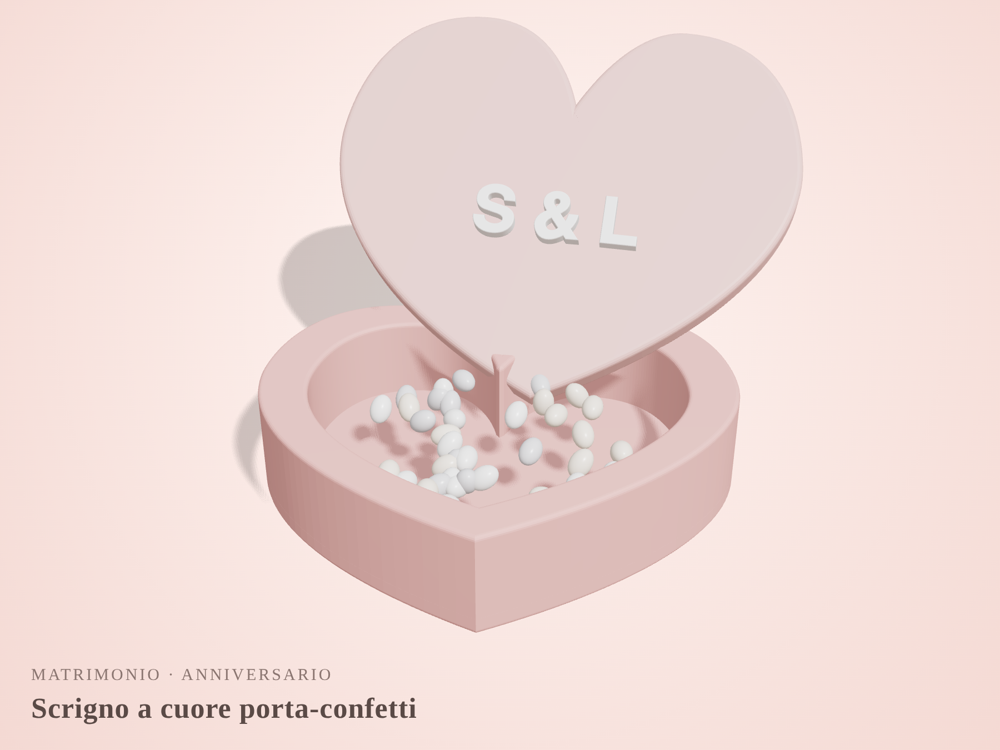
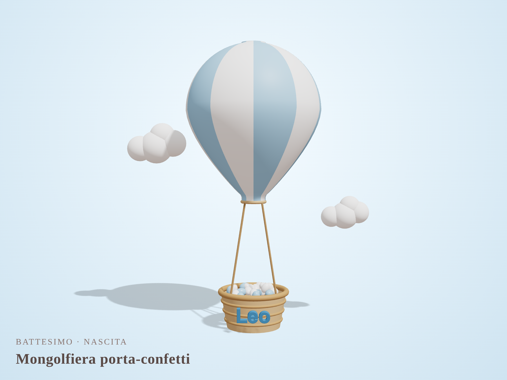
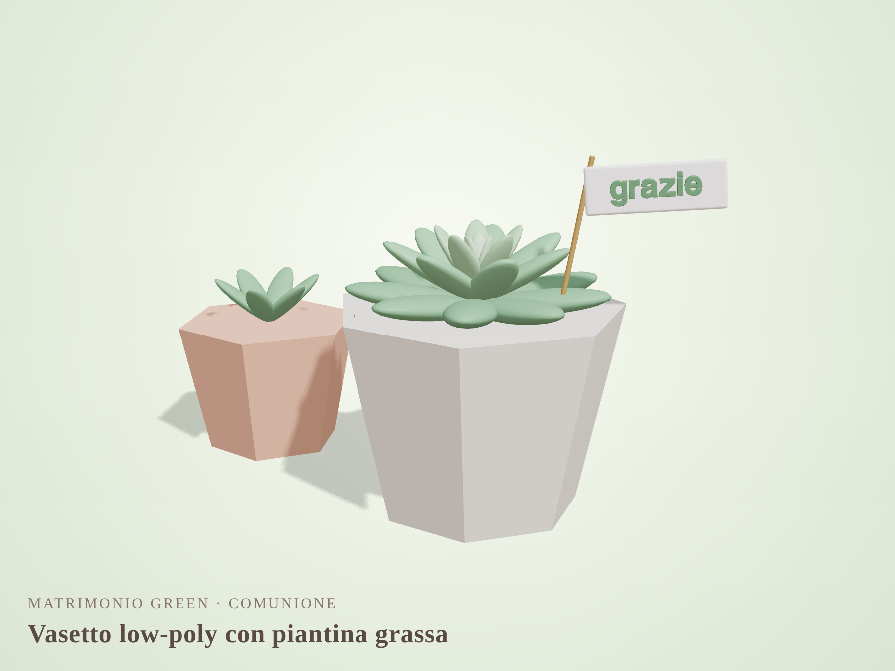
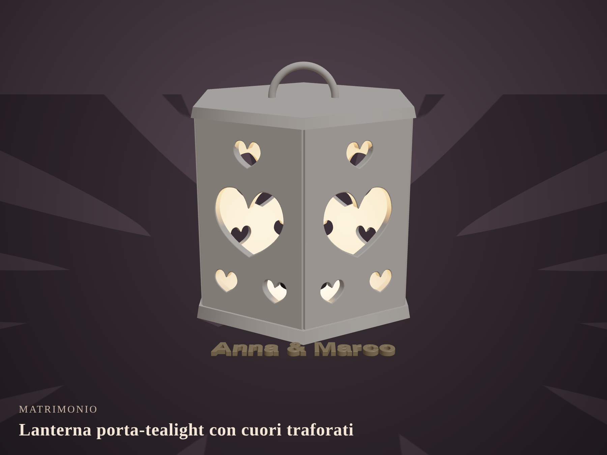
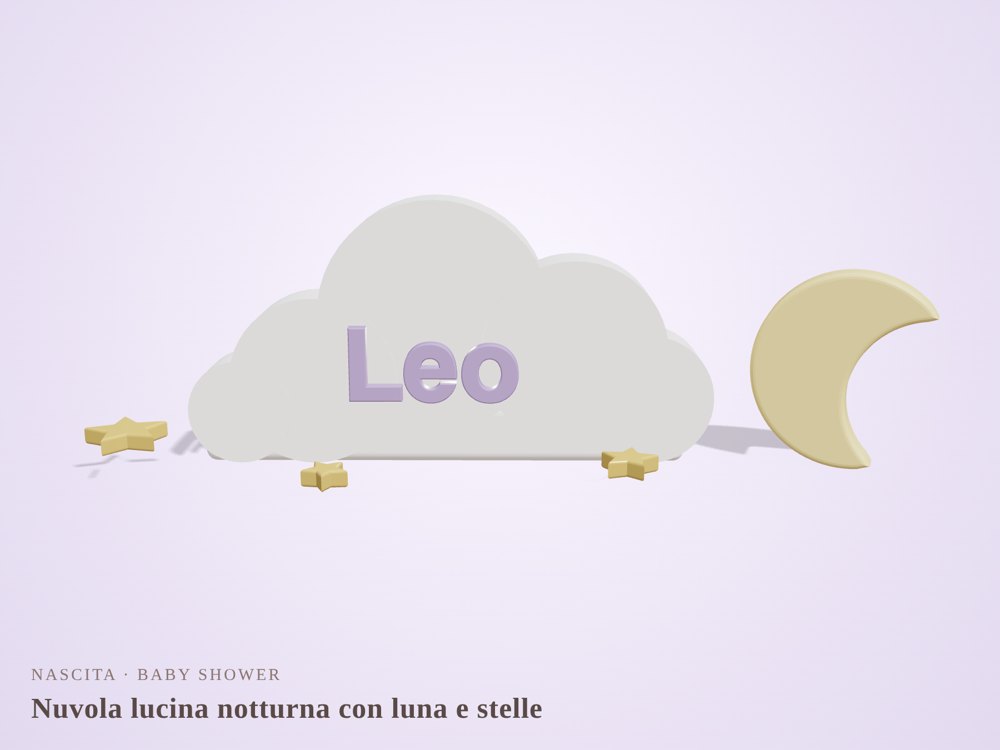
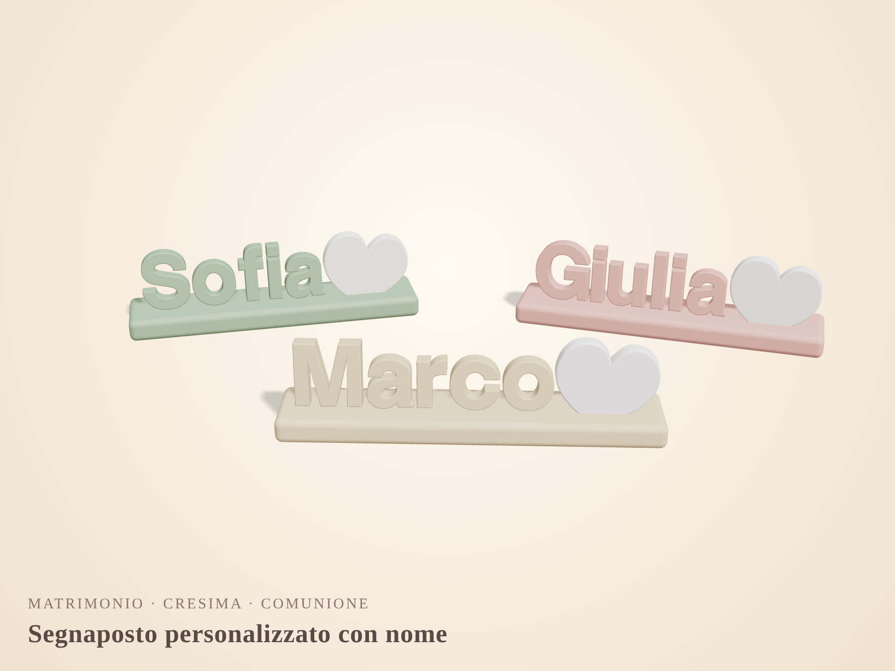

# Idee per bomboniere stampate in 3D – Emozioni in 3D

Concept illustrativi (rendering generati con Three.js da `scene.html`), da usare come spunto e non come modelli definitivi.

## 1. Scrigno a cuore porta-confetti

- **Per:** matrimonio, anniversario, San Valentino
- Base a cuore cava con coperchio a incastro e iniziali in rilievo.
- **Varianti:** coperchio con calamita, iniziali in un secondo colore (cambio filamento), finitura seta/perla.
- **Stampa:** circa 1,5–2 h a pezzo in PLA; si stampa senza supporti.

## 2. Mongolfiera porta-confetti

- **Per:** battesimo, nascita, primo compleanno
- Pallone a spicchi bicolore e cestino con nome che contiene 3–5 confetti.
- **Varianti:** mongolfiera da appendere (con gancio) oppure appoggiata su una nuvoletta-base. Colori azzurro, rosa o salvia.

## 3. Vasetto low-poly con piantina grassa

- **Per:** matrimonio “green”, comunione, eventi aziendali
- Vasetto geometrico con una succulenta vera (o finta) e una bandierina “grazie”.
- **Plus:** è una bomboniera utile che non si butta. Il vasetto è veloce da stampare in modalità spirale (vase mode).

## 4. Lanterna porta-tealight con cuori traforati

- **Per:** matrimonio, nozze d’argento
- Pannelli traforati che proiettano cuori di luce sul tavolo; da usare con candela LED.
- **Varianti:** trafori con iniziali, data o skyline della città degli sposi. Una versione **litofane** (foto degli sposi che compare in controluce) è un ottimo prodotto premium.

## 5. Nuvola lucina notturna con luna e stelle

- **Per:** nascita, baby shower, battesimo
- Nuvola con il nome del bimbo; luna e stelline come magneti o ciondoli.
- **Varianti:** nuvola in PLA bianco sottile con un LED a bottone dentro, che fa da lucina notturna.

## 6. Segnaposto personalizzato con nome

- **Per:** qualsiasi evento; fa sia da segnaposto sia da bomboniera.
- Nome dell’invitato in rilievo su una base, con un cuore (o il simbolo del tema).
- **Plus:** si personalizza in automatico da un file di testo (OpenSCAD/script), quindi va bene per centinaia di invitati.

---

## Altre idee veloci (senza immagine)
- **Portachiavi a puzzle**: due metà che si incastrano (sposi o genitori + bimbo).
- **Calamite iniziali + data**: economiche e leggere, ideali per grandi numeri.
- **Diffusore per profumo** con bastoncini e boccetta: vasetto geometrico abbinato al tema.
- **Albero della vita** su una base con la data, anche come cornicetta.
- **Scatolina a esagono / alveare** componibile: le scatole degli invitati si uniscono in un “favo”.
- **Ciondolo/addobbo natalizio** con nomi e data: per eventi di dicembre, da appendere all’albero.
- **Mini cornice** che regge una foto Instax.
- **Tema laurea**: tocco e pergamena porta-confetti.

## Consigli pratici
- **Materiale:** PLA o PLA silk per la resa estetica. Per contatto diretto con i confetti, usare un sacchetto di tulle oppure filamento certificato per alimenti.
- **Tempi:** pianificare in base al numero di pezzi (es. 80 invitati × 1,5 h = 120 h macchina).
- **Packaging:** bigliettino con QR alla galleria foto dell’evento come tocco “tech”.
- **Prezzi indicativi:** segnaposto e calamite in fascia bassa, porta-confetti in fascia media, lanterne e litofanie premium.
