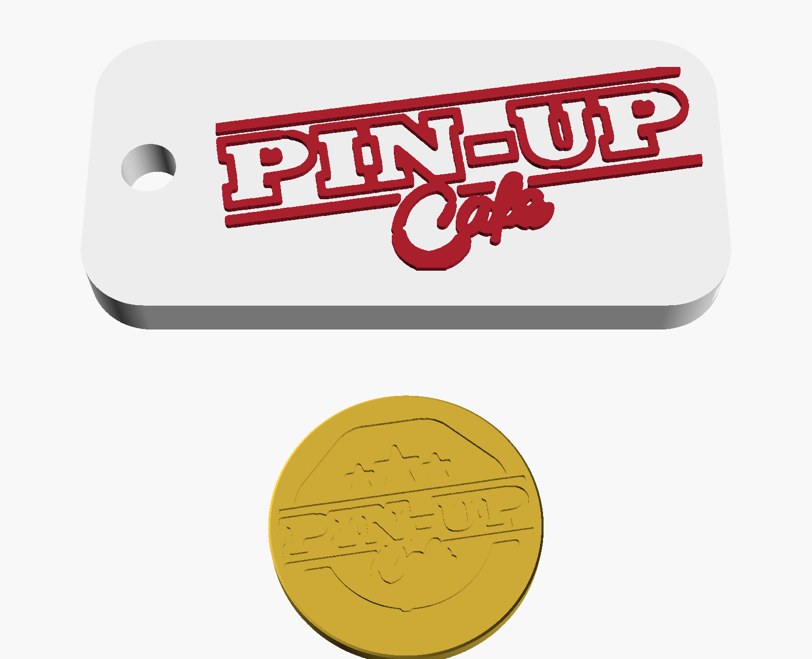
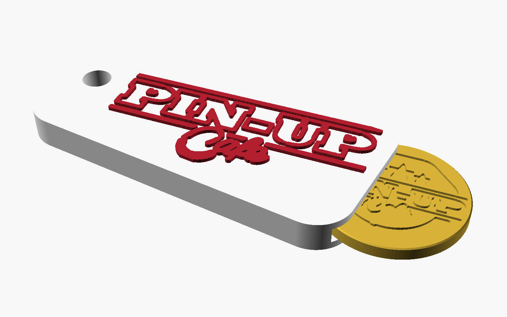
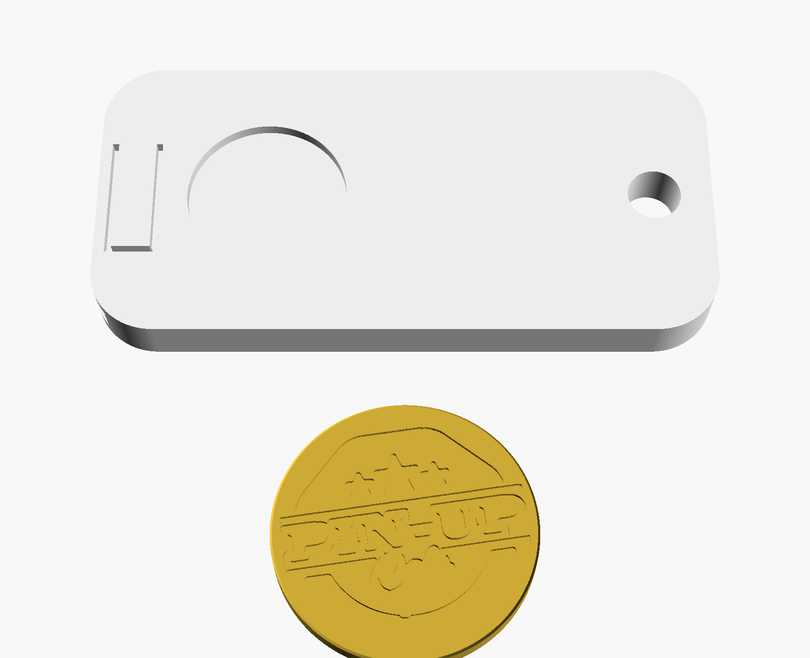
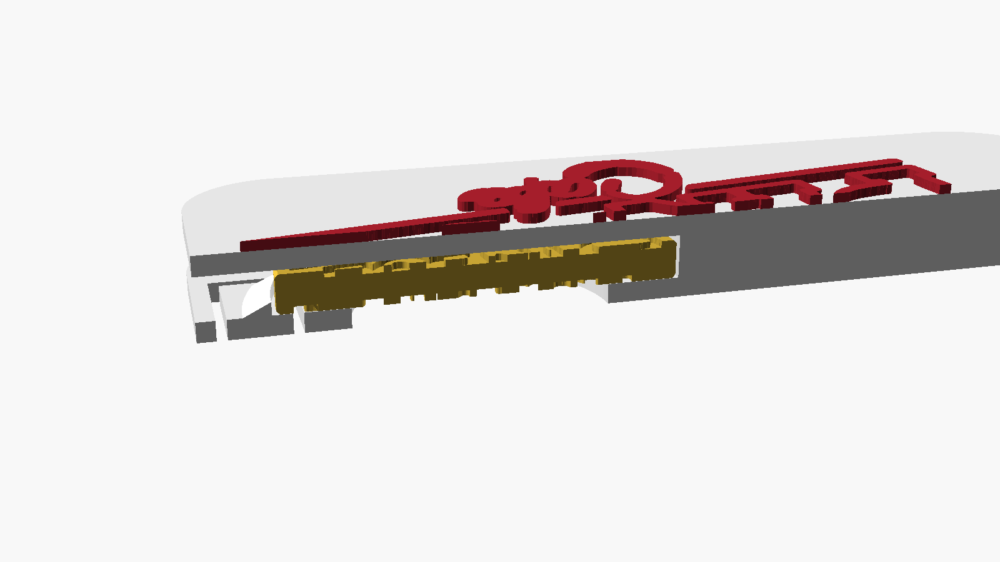

# Portachiavi PIN-UP Cafe con gettone per carrello

Versione per **ugello 0,4 mm** e **un filamento alla volta**.



## I due pezzi

| Pezzo | Misure | Logo |
|---|---|---|
| **Portachiavi** (`stl/portachiavi.stl`) | 58 × 28 × 5,6 mm, foro chiavi Ø 5 mm | logo lungo **in rilievo** (0,6 mm) sul davanti |
| **Gettone** (`stl/gettone.stl`) | Ø 23,25 × 2,33 mm, come una moneta da 1 € | logo tondo **inciso** (0,4 mm) su entrambe le facce |

## Come funziona l'incastro

Il gettone si **infila dentro** il portachiavi da una fessura sul lato corto, dalla parte opposta al foro per le chiavi.



- Nel fondo c'è una **linguetta elastica** con un **dentino**. Mentre il gettone entra, la linguetta si abbassa. A gettone inserito scatta dietro il suo bordo e lo blocca: non esce da solo.
- Per **toglierlo**, premi la linguetta dal retro con un dito e spingi il gettone verso l'uscita con il pollice, attraverso la **finestra rotonda** sul retro.




## Stampa

### Portachiavi: base bianca, scritta colorata
- Va stampato **così com'è**, con il retro (la finestra) sul piatto e il logo verso l'alto. Non serve nessun supporto.
- **Cambio colore a 5,0 mm**: in Bambu Studio, OrcaSlicer o PrusaSlicer, nell'anteprima strati vai allo strato **5,0–5,2 mm** e aggiungi un *cambio filamento* (il "+" accanto al cursore). Si stampa in bianco fino a lì, poi la stampante si ferma, carichi il rosso o il nero e riparte per la scritta.
- Il tetto sopra il gettone è un **ponte** di circa 24 mm. Con il PLA e la ventola al massimo sui ponti viene bene.
- Strato 0,2 mm, 3 perimetri, riempimento 20–30%.

### Gettone
- Stampa in un colore solo, piatto sul letto, nessun supporto.
- Strato 0,2 mm, **riempimento 100%**: più rigido e più pesante, simile a una moneta.
- Se il logo inciso sotto (quello a contatto col piatto) esce poco definito, metti `INCISO_SU_DUE_FACCE = False` in `genera_portachiavi.py`: resta inciso solo sopra.

## Regolazioni dopo la stampa di prova

Ogni stampante ha tolleranze diverse. Tutti i valori sono in cima a `genera_portachiavi.py`.

| Problema | Cosa cambiare |
|---|---|
| Il gettone entra **troppo duro** | `DENTINO_ALTEZZA` 0,8 → 0,6, oppure `LINGUETTA_LUNGHEZZA` 11 → 13 |
| Il gettone **esce da solo** | `DENTINO_ALTEZZA` 0,8 → 1,0 |
| La sede è **troppo stretta** | `GIOCO_DIAMETRO` 0,4 → 0,6 |
| Il gettone è **largo per il carrello** | `DIAMETRO_GETTONE` 23,25 → 23,1 |

Per rigenerare gli STL:

```bash
pip install manifold3d trimesh opencv-python-headless numpy
python3 genera_portachiavi.py
```

## Nota sul logo

A queste dimensioni la scritta "FOOD · ON · MUSIC · ROW" del logo tondo sarebbe alta circa 0,6 mm: è stata tolta perché non è stampabile. I tratti sottili sono stati ingrossati ad almeno 0,45–0,5 mm. Per rifare i livelli del logo partendo da un'immagine nuova (serve `potrace`):

```bash
cd loghi
python3 ../../../strumenti/logo_to_svg.py logo_lungo_originale.jpg logo_lungo --crop-bottom 100 --fit-width 45 --fit-height 21 --min-width 0.5 --upscale 2
python3 ../../../strumenti/logo_to_svg.py logo_tondo_originale.jpg logo_tondo --crop-bottom 60 --fit-circle 21.4 --min-width 0.45 --min-area-mm2 0.5 --upscale 2
```
