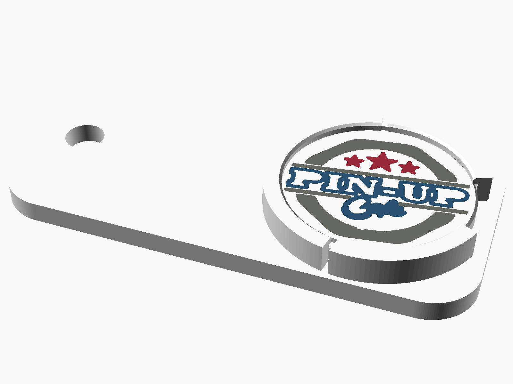

# Portachiavi PIN-UP Cafe con gettone per carrello


## Cosa contiene

| Pezzo | Misure | Logo |
|---|---|---|
| **Portachiavi** | 58 × 28 × 6 mm, foro per anello Ø 5 mm | logo lungo "PIN-UP Cafe" sul davanti |
| **Gettone** | Ø 23,25 × 2,33 mm, come una moneta da 1 € | logo tondo su entrambe le facce |

Il gettone si incastra a scatto in un anello sul retro del portachiavi:

- un **labbro** di 0,45 mm copre il bordo del gettone e lo tiene fermo;
- due **fessure laterali** rendono l'anello elastico, così il gettone entra con un "clic";
- un'**apertura** sul lato corto serve a infilare l'unghia e sfilare il gettone per usarlo nel carrello.



## File da stampare

- `portachiavi_pinup_multicolore.3mf`: **file consigliato**. Contiene entrambi i pezzi, già divisi per colore.
- `stl/`: un file STL per ogni colore di ciascun pezzo, nel caso lo slicer non legga bene il 3MF.

### Colori

| Parte | Bianco | Blu | Grigio | Rosso |
|---|---|---|---|---|
| Portachiavi | `portachiavi_bianco.stl` | `portachiavi_blu.stl` | `portachiavi_grigio.stl` | – |
| Gettone | `gettone_bianco.stl` | `gettone_blu.stl` | `gettone_grigio.stl` | `gettone_rosso.stl` |

In Bambu Studio, OrcaSlicer o PrusaSlicer:
1. Apri il 3MF. Se usi gli STL, selezionali tutti insieme e rispondi **"Sì"** alla domanda *"caricare come un unico oggetto con più parti?"*.
2. Assegna a ogni parte il filamento del colore corrispondente.
3. Non spostare né ruotare le singole parti: sono già allineate e orientate per la stampa.

## Impostazioni di stampa consigliate

- **Materiale**: PLA o PETG. Il PETG è più elastico e tiene meglio lo scatto nel tempo.
- **Ugello** 0,4 mm, **altezza strato 0,2 mm** (i loghi occupano esattamente 3 strati).
- **Prima linea** a 0,2 mm (non 0,3): altrimenti il logo sul davanti si schiaccia.
- **Piatto liscio o testurizzato**: sul liscio il logo esce lucido, sul testurizzato satinato.
- Riempimento 100% per il gettone (più peso, sensazione di moneta vera); 30–40% per il portachiavi.
- Nessun supporto.
- Ironing (stiratura) sulla faccia superiore del gettone: facoltativo, la rende più liscia.

## Note importanti

- **Dettagli del logo.** A queste dimensioni la scritta "FOOD · ON · MUSIC · ROW" del logo tondo sarebbe alta circa 0,6 mm e non si può stampare con un ugello da 0,4: è stata tolta. I contorni sottili sono stati ingrossati a 0,45–0,5 mm. La parola "Cafe" del gettone è al limite: va controllata sulla prima stampa di prova.
- **Prova dello scatto.** Ogni stampante ha tolleranze diverse. Stampa una prova e:
  - se il gettone è **troppo duro** da inserire, abbassa `SPORGENZA_LABBRO` (es. 0,35) o alza `GIOCO_DIAMETRO`;
  - se è **troppo lento**, alza `SPORGENZA_LABBRO` (es. 0,55).
- **Carrello.** Il gettone ha le stesse misure della moneta da 1 €. Se risulta un po' largo per alcuni carrelli, porta `DIAMETRO_GETTONE` a 23,1.

## Modificare e rigenerare

Tutte le misure sono parametri in cima a `genera_portachiavi.py`.

```bash
pip install manifold3d trimesh opencv-python-headless scikit-image numpy
python3 genera_portachiavi.py
```

Per rifare i livelli colore partendo da un logo nuovo (serve `potrace`):

```bash
cd loghi
python3 ../../../strumenti/logo_to_svg.py logo_lungo_originale.jpg logo_lungo --crop-bottom 100 --fit-width 45 --fit-height 21 --min-width 0.5 --upscale 2
python3 ../../../strumenti/logo_to_svg.py logo_tondo_originale.jpg logo_tondo --crop-bottom 60 --fit-circle 21.4 --min-width 0.45 --min-area-mm2 0.5 --upscale 2
```
