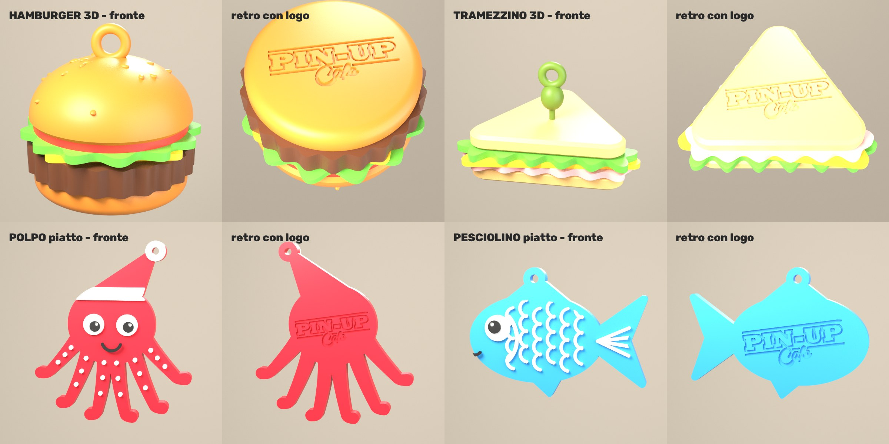
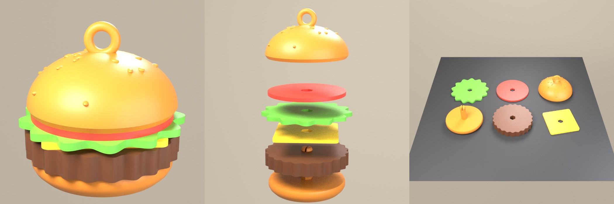
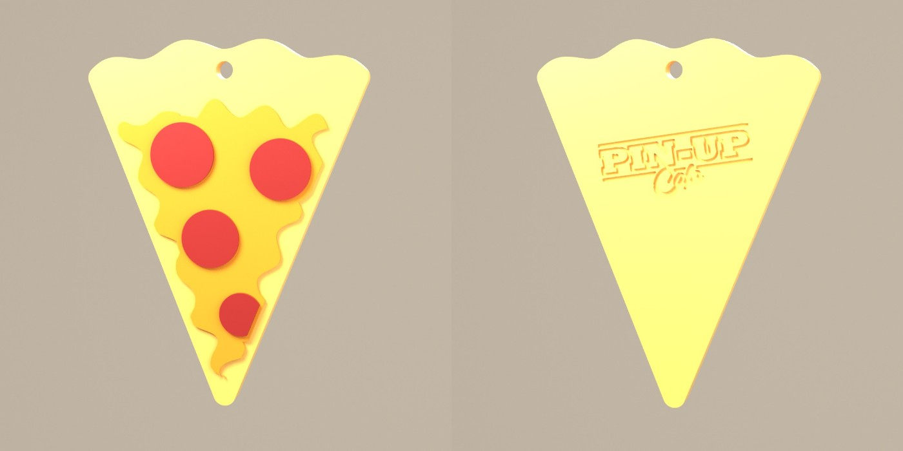
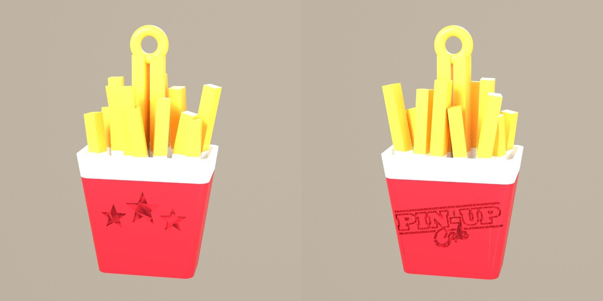
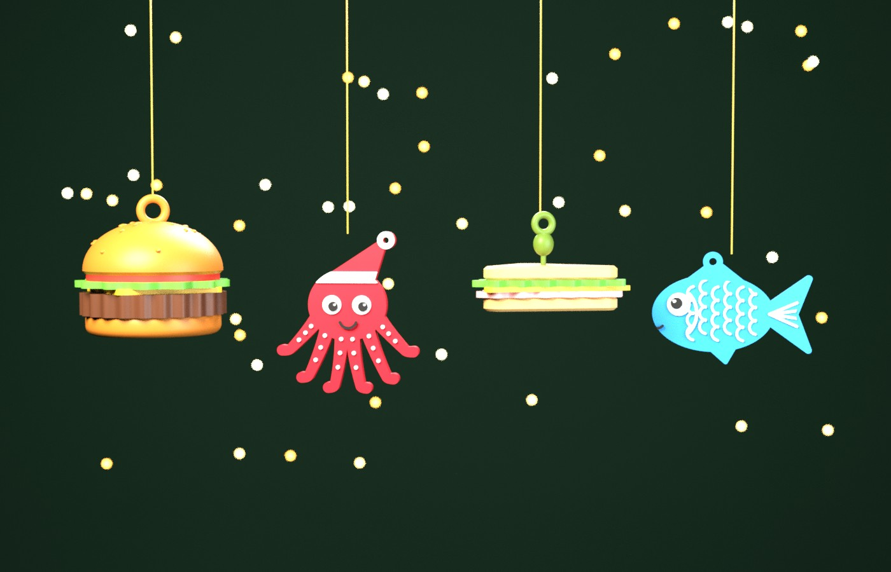

# Addobbi di Natale PIN-UP Cafe (bozze)

Sei addobbi da 6-8 cm per l'albero, con il logo PIN-UP inciso sul retro.


## Hamburger a pezzi



Ogni pezzo si stampa in un colore solo; si possono riempire interi piatti dello stesso colore (tutti i pani, poi tutte le carni, ecc.).

- **Pane sotto** con un **perno esagonale** (8 mm): carne, formaggio, insalata e pomodoro hanno un foro esagonale e si infilano sul perno; l'esagono li tiene allineati.
- In cima al perno c'è una **clip a scatto** (due metà elastiche con un dentino) che si aggancia nella sede del **pane sopra**: si preme e fa "clic".
- Per un addobbo definitivo basta una goccia di colla nella sede del pane sopra.
- Nessun supporto: il pane sotto ha il bordo inferiore a 45°, il pane sopra si stampa con la parte piatta sul piatto.





| Addobbo | Tipo | Misure | Colori (cambio filamento a strati) |
|---|---|---|---|
| Hamburger | 3D, **a pezzi** | 68 × 68 × 63 mm | 6 pezzi, ognuno di un colore: **nessun cambio filamento** |
| Tramezzino | 3D | 71 × 63 × 44 mm | pane, prosciutto, formaggio, insalata, pane, oliva |
| Polpo | piatto, 5,8 mm | 65 × 73 mm | rosso + dettagli bianchi + dettagli neri |
| Pesciolino | piatto, 5,8 mm | 71 × 51 mm | azzurro + dettagli bianchi + dettagli neri |
| Patatine | 3D | 42 × 23 × 76 mm | cartoccio rosso (stelle davanti, logo dietro), fascia bianca, patatine gialle |
| Pizza | piatto, 5,6 mm | 54 × 71 mm | giallo chiaro (impasto) + giallo scuro (formaggio) + rosso (salame) |

**Regola per gli addobbi piatti:** i colori si susseguono dal basso verso l'alto senza mai tornare a un colore già usato, quindi bastano al massimo 2 cambi filamento (es. rosso → bianco → nero).

Sono **bozze per i rendering**: dopo l'approvazione si preparano i file 3MF di stampa, con le quote dei cambi colore.

Per rigenerare:

```bash
python3 genera_addobbi.py                                      # modelli -> parti/
blender -b -P render_blender.py -- polpo fronte out.png 64     # rendering (fronte | retro | gruppo)
```
